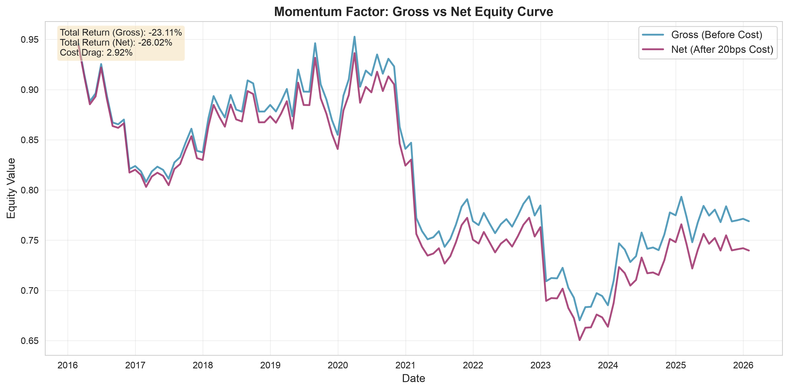

# 因子/组合回测

## 0. 研究目标与研究设计

**核心研究问题**

> 在美国股票市场中，价格/风险相关的横截面因子（如动量、短反转、低波、趋势）是否能在**扣除交易成本后**产生稳定的多空收益？这些收益在不同市场环境/子样本中是否稳健？

**关键设计选择**

* 样本池：S&P 500
* 频率：月度调仓
* 组合形式：market-neutral long-short（净暴露≈0）
* 评价：Sharpe、MaxDD、换手、成本敏感性、IC/IR、子样本稳定性

---

# 1) 数据层（Data Layer）

## 1.1 Universe（样本池）

* 固定一份 tickers 列表（例如 150–300 只）

## 1.2 需要的数据字段

* `Adj Close`（复权收盘价）
* `Volume`（做流动性 proxy）
* 交易日历（日期索引）

## 1.3 数据清洗

* 处理缺失值：某股票缺失超过 X% 的月份则当期剔除
* 对齐：所有股票收益在同一时间点对齐（避免未来数据混进来）
* 复权：必须用复权价算收益（用 Adj Close）

---

# 2) 因子层（Factor Layer）

## 2.1 因子选择

1. **动量（12-1 momentum）**

* ( $MOM_{t} = R_{t-12m, t-1m}$ )

2. **短期反转（1M reversal）**

* ( $REV_{t} = -R_{t-1m, t}$ )

3. **低波（low volatility）**

* ( $LOWVOL_{t} = -\sigma(\text{daily returns over last 3m}$) )

4. **趋势（time-series trend, 200D MA gap）**

* ( $TREND_t = \frac{P_t}{MA_{200}(P)_t} - 1$ )

5. **流动性/成交量冲击（volume/turnover proxy）**

* 用成交额或换手 proxy 做“流动性风险”的控制

## 2.2 因子预处理

对每个月的横截面因子值做：

### (1) Winsorize 去极值（防止少数点把回测扭曲）

* 把因子截断在 1%–99% 或 5%–95%

### (2) 标准化（z-score），才能多因子合成

* ( $z_i = \frac{x_i - \mu}{\sigma}$ )

### (3) 缺失处理

* 因子缺失：当期该股票不参与排序/建仓

---

# 3) 中性化（Neutralization）

## 3.1 第一档：Market-neutral

每月：

* 做多 top 20%
* 做空 bottom 20%
* 多空权重等额（总多=1，总空=-1）

这样净暴露≈0。

## 3.2 第二档：Beta-neutral

用过去 252 天日收益回归市场（比如 SPY）得到每只股票 beta：

* 对每月持仓，调整权重使得
  ( $\sum w_i \beta_i \approx 0$ )

## 3.3 第三档：行业中性

在每个行业内部做 top/bottom，再合并。
（需要 ticker → sector 的映射表）

---

# 4) 组合构建（Portfolio Construction）

## 4.1 排序型

* Top/Bottom 分位数
* 权重等权或按排名线性

## 4.2 风险调整权重

用过去 63 天波动率做风险平价（简化版）：

* ( $w_i \propto \frac{1}{\sigma_i}$ )
  并在多头和空头各自归一化

## 4.3 多因子合成

把多个因子 z-score 后平均：

* ( $score = \frac{1}{K}\sum_k z_{k}$ )

再按 score 排序构建组合。

---

# 5) 交易与回测（Backtest Engine）

## 5.1 时间对齐（最重要：防 look-ahead）

* 月末 t 计算因子
* 用 **t+1 的开盘或下一个交易日收盘** 建仓
  实现上至少做到：**信号 shift(1)**

## 5.2 收益计算

* 计算组合在下个月的收益
* 多空收益：
  ( $r_{LS} = r_{long} - r_{short}$ )

## 5.3 换手率（Turnover）

用定义（每期）：

* ( $TO_t = \frac{1}{2}\sum_i |w_{i,t} - w_{i,t-1}|$ )

## 5.4 交易成本模型（你要做“敏感性分析”）

* 成本 = `TO_t * cost_bps`
* 做 3 档：10/20/30 bps
  输出不同成本下的 Sharpe 和年化收益。

---

# 6) 评估指标（Evaluation）

## 6.1 交易绩效

* 年化收益、年化波动
* Sharpe（无风险利率设 0 ）
* Max Drawdown
* 月胜率、偏度/峰度

## 6.2 因子有效性：IC/IR

每期算：

* IC = Spearman corr(因子值, 下一期收益)
* IR = mean(IC) / std(IC)

输出：

* IC 时间序列
* 平均 IC、IC t-stat

## 6.3 暴露检查（Exposure）

至少做：

* 市场 beta（是否接近 0）
  
  展示对比：
  
* neutral 前 beta

* neutral 后 beta

---

# 7) 稳健性（Robustness）

1. **子样本**：2015–2019 vs 2020–2025
2. **分位数参数**：Top/Bottom 10% vs 20% vs 30%
3. **成本敏感性**：10/20/30 bps
4. **再平衡频率**：月度 vs 双月/季度

---

# 8) 交付与展示（Deliverables）

`results/` 里有：

**图**

* 多空净值曲线（含成本 vs 不含成本对比）
* 回撤曲线（Drawdown）
* IC 序列图（或 IC 分布直方图）

**表**

* Performance summary：年化收益/波动/Sharpe/MaxDD/换手
* Robustness table：不同成本/子样本/分位数下的对比

# 9) Key Results（关键结果）

> **2026-11-15 更新**：本节数字是修复以下问题后重新跑出来的，与此前版本不可比（旧版"动量年化 +0.19%"是因子方向写反的结果）：
> 动量因子方向写反、反转因子多滞后一个月、同一只股票同时在多空两侧、年化收益漏算第一期、回撤未计入初始净值、
> Beta 的基准不是真实 SPY、最后一个不完整月被当成整月。对应的回归测试在 `tests/`。

## 9.0 实际回测配置与复现

| 项目 | 取值 |
|------|------|
| 样本 | 当前 S&P 500 成分股，去重并剔除缺失过多后 472 只 |
| 区间 | 月收益 2015-02 ~ 2026-01；动量回测 2016-02 ~ 2026-01（120 个月） |
| 调仓 | 每 2 个月调仓，最小持有期 12 个月 |
| 选股 | 排名前/后 25% 进入，掉出前/后 30% 才退出（等权，多头 +1 / 空头 −1） |
| 成本 | 20 bps × 换手率 |
| 市场基准 | SPY（复权价月收益） |

注意：这套配置（为降低换手而加的持有期和进出阈值）与上文第 3、4 节描述的"月度调仓、前后 20%"不同，以本表为准。

```bash
pip install -r requirements.txt
python scripts/download_data.py --start 2015-01-01 --end 2026-02-05   # 下载数据到 data/cache/
python scripts/run_evaluation.py                                      # 生成 results/ 下的表格和报告
python scripts/generate_figures.py                                    # 生成 results/figures/ 下的图
python -m pytest                                                      # 回归测试
```

## 9.1 各因子表现总览

| 因子 | 年化收益(毛) | 年化收益(净) | 年化波动 | Sharpe | 最大回撤 | 平均换手率 |
|------|-------------|-------------|---------|--------|----------|-----------|
| Trend | -0.71% | -1.10% | 7.70% | -0.11 | -26.14% | 16.69% |
| Reversal | -0.23% | -0.65% | 4.17% | -0.13 | -14.94% | 17.57% |
| **Momentum** | **-2.59%** | **-2.97%** | **9.02%** | **-0.29** | **-34.94%** | **16.03%** |
| Composite | -4.98% | -5.35% | 8.61% | -0.59 | -42.63% | 16.31% |
| LowVolatility | -9.62% | -9.91% | 12.66% | -0.76 | -69.99% | 13.28% |

**统计显著性（Momentum）**: Newey-West t-stat = -0.94, p = 0.346（**不显著**）；IC 均值 = -0.008, t = -0.45。

**结论**: 在这个样本和配置下，没有任何一个因子在扣除成本后取得正收益。Momentum 的负收益在统计上不显著，
即没有证据表明它有稳定的超额收益，也没有证据表明反向做就能赚钱。

---

## 9.2 核心可视化结果

### 毛收益 vs 净收益对比



**关键发现**: Momentum 扣成本前就是亏的（年化 -2.59%），20bps 成本每年再拖累约 0.38 个百分点。

---

### 成本敏感性分析


**关键发现**:
- 10 / 20 / 30 / 40 / 50 bps 下年化净收益依次为 -2.78% / -2.97% / -3.16% / -3.34% / -3.53%
- **结论**: 换手率不高（约 16%），成本不是主要矛盾；问题在于因子本身在这段样本里没有选股能力

---

### 市场暴露：Alpha & Beta


**关键发现**（基准为 SPY）:
- **Momentum Beta = -0.17**（超过 0.1 阈值），R² = 0.08：组合只做到资金中性，没有做到 Beta 中性
- **Momentum Alpha ≈ 0.0001/月**（接近零），扣除市场影响后没有显著的纯因子收益
- LowVolatility 的 Beta 达 -0.50，它的大幅亏损很大一部分是在牛市里净做空市场造成的
- **改进方向**: 需实施 Beta-Neutral 中性化

---

## 9.3 已知局限

- **幸存者偏差（未修复）**: 股票池用的是"今天"的 S&P 500 成分股名单回测 2015 年以来的历史，
  等于提前知道哪些公司会留在/进入指数。要消除需要历史成分股数据。
- **成分股名单会变**: 不同日期下载到的股票池略有差异，重跑结果不会和上表逐位一致。
- **Alpaca 交叉验证未实测**: 未配置 API key 时只使用 yfinance 单一数据源。

---

## 9.4 完整报告

详细分析请参阅：
- [Evaluation Report](results/EVALUATION_REPORT.md) - 综合评估报告
- [CAGR Diagnostics](results/cagr_diagnostics.md) - 年化收益计算验证
- [All Figures](results/figures/) - 完整图表集
- [Results Snapshot](docs/03_results_snapshot.md) - 修复前的旧版快照（数字已过时，仅作记录）

---
