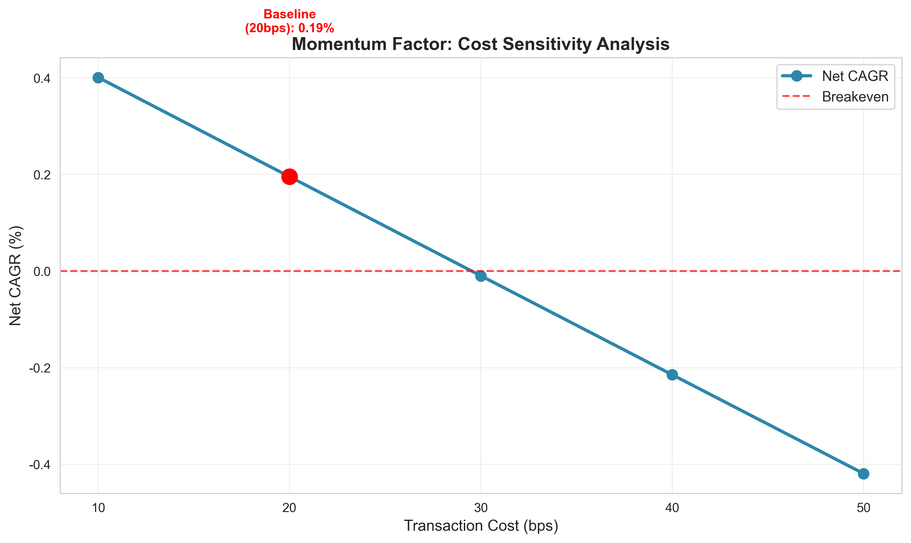
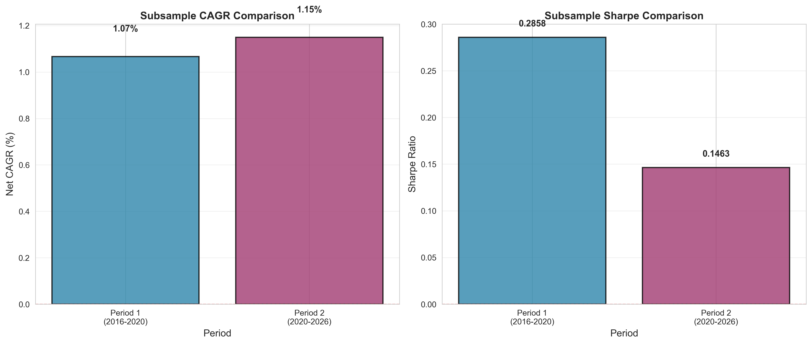
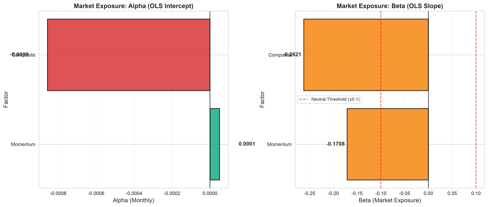

# 因子/组合回测

用美股 S&P 500 成分股，检验 5 个常见的价格类因子（动量、短期反转、低波、趋势、流动性）做成多空组合后，扣掉交易成本还能不能赚钱。

**当前结论**：在这个样本（2015 ~ 2026-01）和配置下，所有因子和合成因子扣除成本后都是负收益，不扣成本也是负的。数字见第 9 节。

**在线报告**：[带交互图表的网页版报告](https://c-zhhhhh.github.io/factor-longshort-eval/results/report.html)（净值与回撤、各策略对比、稳健性、市场暴露、Beta 对冲前后）。

> 第 0–8 节讲研究设计和**代码实际做了什么**。当初设计了但没有实现、或者实现了但没用在正式结果里的部分，都用"未实现 / 未使用"标了出来。
> 第 9 节是结果。

## 快速开始

```bash
pip install -r requirements.txt
python scripts/download_data.py --start 2015-01-01 --end 2026-02-05   # 下载数据到 data/cache/
python scripts/run_evaluation.py                                      # 生成 results/ 下的表格、报告和网页版报告
python scripts/generate_figures.py                                    # 生成 results/figures/ 下的图
python -m pytest                                                      # 回归测试（不联网、不需要数据）
```

- Python ≥ 3.9（第 9 节的结果是在 Python 3.12 下跑出来的）。
- 跑完后用浏览器打开 `results/report.html` 就能看到带图表的网页版报告（单文件，不联网也能看）。
- 如果你的缓存是以前下载的，评估会提示缺少 SPY 的每日数据。运行 `python scripts/download_data.py --add-benchmark-daily` 补上这一项即可，不会重新下载股票。
- 数据默认只用 yfinance，不需要任何账号。Alpaca 是可选的第二数据源，配置方法见 [docs/ALPACA_SETUP.md](docs/ALPACA_SETUP.md)。

## 目录结构

```
data/           数据下载、清洗、缓存
factors/        5 个因子 + 去极值/标准化 + 因子合成
portfolio/      选股、权重、资金中性
backtest/       时间对齐、回测循环、交易成本、绩效指标
evaluation/     IC、显著性检验、市场暴露、稳健性、多因子对比
visualization/  静态图表、网页版报告
utils/          配置、日志、日期工具
scripts/        可以直接运行的入口脚本
tests/          回归测试
results/        正式结果（表格、报告、图）
```

除 `scripts/` 和 `results/` 外，每个目录下都有一份 `CLAUDE.md` 说明该目录里各文件的职责。

---

## 0. 研究目标与研究设计

**核心研究问题**

> 在美国股票市场中，价格/风险相关的横截面因子（如动量、短反转、低波、趋势）是否能在**扣除交易成本后**产生稳定的多空收益？这些收益在不同市场环境/子样本中是否稳健？

**关键设计选择**

* 样本池：当前 S&P 500 成分股
* 频率：月频数据，每 2 个月调仓一次
* 组合形式：资金中性的多空组合（多头权重合计 +1，空头合计 −1，净资金暴露 = 0）
* 评价：Sharpe、MaxDD、换手、成本敏感性、IC/IR、子样本稳定性

---

# 1) 数据层（Data Layer）

## 1.1 Universe（样本池）

* 从 Wikipedia 抓取**当前**的 S&P 500 成分股名单（503 个代码）
* 同一家公司的多类股票只留成交量更高的一个（如 GOOGL / GOOG 只留 GOOGL）
* 剔除缺失过多的股票后，实际进入回测的是 **472 只**
* 用今天的名单回测过去，存在幸存者偏差，见 9.3

## 1.2 需要的数据字段

* `Adj Close`（复权收盘价，所有收益都用它算）
* `Volume`（成交量，流动性因子用）
* SPY 的复权价（作为市场基准，计算 Beta 用）

## 1.3 数据清洗

* 缺失：某只股票缺失的交易日超过 30%，整只剔除；零星缺失最多向前填充 5 天
* 月收益：月末复权价的环比涨跌幅
* 不完整的月份：如果数据的最后一个月没走完，这个月不计入（否则会把半个月当成整月）
* 数据源：默认只用 yfinance。代码支持再用 Alpaca 交叉验证（两边价格差异超过 1% 的点标记为缺失），
  但需要自己配置 API key，**这条路径没有实测过**

---

# 2) 因子层（Factor Layer）

## 2.1 因子选择

时间约定：**月末 t 的因子值只用到 t 当天为止的数据**。"用 t 的因子去赚 t+1 的收益"这一步滞后统一在回测引擎里做一次（见 5.1），因子内部不再额外滞后。

1. **动量（12-1 momentum）**：过去 12 个月的涨幅，跳过最近 1 个月

* ( $MOM_{t} = \frac{P_{t-1m}}{P_{t-12m}} - 1$ )

2. **短期反转（1M reversal）**：当月涨得多的，预期下月回落

* ( $REV_{t} = -R_{t}$ )，$R_t$ 是 t 月的收益率

3. **低波（low volatility）**：过去 3 个月（63 个交易日）日收益的标准差，取负号

* ( $LOWVOL_{t} = -\sigma(\text{daily returns over last 63d})$ )

4. **趋势（200D MA gap）**：价格相对 200 日均线的偏离

* ( $TREND_t = \frac{P_t}{MA_{200}(P)_t} - 1$ )

5. **流动性（dollar volume）**：过去 63 个交易日平均成交额的对数

* ( $LIQ_t = \log(\overline{P \times Volume}_{63d})$ )
* 这个因子**不在正式评估里**（`scripts/run_evaluation.py` 只跑前 4 个因子和它们的合成）。
  它的结果单独放在 [FINAL_SUMMARY.md](FINAL_SUMMARY.md)

所有因子都是"因子值越高越做多"。

## 2.2 因子预处理

对每个月的横截面因子值做：

### (1) Winsorize 去极值（防止少数点把回测扭曲）

* 把因子截断在当月的 1%–99% 分位之间

### (2) 标准化（z-score），才能多因子合成

* ( $z_i = \frac{x_i - \mu}{\sigma}$ )

### (3) 缺失处理

* 因子缺失：当期该股票不参与排序/建仓

---

# 3) 中性化（Neutralization）

## 3.1 第一档：资金中性（已实现，正式结果用的就是这个）

* 多头权重合计 +1，空头权重合计 −1，所以权重总和 = 0
* 同一只股票同一期不会同时出现在多头和空头

资金中性只保证多空两边的钱一样多，**不保证组合不随大盘涨跌**。实测各组合对 SPY 的 Beta 并不接近 0（动量 −0.17，低波 −0.50），见 9.2。

## 3.2 第二档：Beta 对冲（已实现，作为附加对比）

资金中性的组合仍然会跟着大盘涨跌。Beta 对冲的做法是：**不改选股和权重**，在组合之外加一份 SPY 仓位把这部分抵消掉。

1. 用过去 252 个交易日的日收益对 SPY 回归，得到每只股票的 Beta
2. 组合 Beta = ( $\sum w_i \beta_i$ )，只用**上个月末**已知的 Beta（不偷看未来）
3. 对冲仓位 = −组合 Beta（组合 Beta 是 −0.5，就买入 0.5 份 SPY），每月更新
4. 调整对冲仓位也按 20 bps × 换手率扣成本

正式结果（第 9.1 节的表）仍然是**对冲前**的；对冲前后的对比见 9.2。252 天是事先定的常规取值，没有拿回测结果去挑。

简化：对冲仓位没有算资金成本（相当于用期货对冲且不计无风险利率），做空 SPY 的借券费也没算。

## 3.3 第三档：行业中性（未实现）

设计：在每个行业内部分别选前/后分位，再合并（需要 ticker → sector 的映射表）。代码里没有这部分。

---

# 4) 组合构建（Portfolio Construction）

## 4.1 排序型（正式结果的做法）

每 2 个月调仓一次，按因子值排序：

* **进入**：排名进入前 25% 才买入做多，进入后 25% 才卖出做空
* **退出**：要掉出前/后 30% 才平仓（进入线和退出线之间留了一段缓冲，避免在边界上来回买卖）
* **最小持有期**：新进的股票至少持有 12 个月才允许退出
* **权重**：多头内部等权、空头内部等权

缓冲带和最小持有期是为了降低换手率加的。这组参数的由来和问题见 9.0。

## 4.2 风险调整权重（未使用）

设计：按波动率的倒数分配权重 ( $w_i \propto \frac{1}{\sigma_i}$ )，多头和空头各自归一化。

现状：`portfolio/weighting.py` 支持因子值加权和反波动率加权，但正式结果只用了等权，这两种没有评估过。

## 4.3 多因子合成

把多个因子 z-score 后等权平均，再按合成分数排序构建组合：

* ( $score = \frac{1}{K}\sum_k z_{k}$ )

正式结果里的 Composite 是动量、反转、低波、趋势 4 个因子的合成。

---

# 5) 交易与回测（Backtest Engine）

## 5.1 时间对齐（最重要：防 look-ahead）

* 月末 t 计算因子、得到权重
* 这组权重用来赚 **t+1 月**的收益。实现上是对权重做一次 `shift(1)`，只在 `backtest/time_aligner.py` 里做

简化假设：月收益是"月末收盘价到下个月末收盘价"，所以相当于假设能按算出信号的那个月末收盘价成交。没有模拟次日开盘成交、滑点和冲击成本。

## 5.2 收益计算

* 组合当月收益 = 各股票权重 × 当月收益率，再求和
* 因为多头合计 +1、空头合计 −1，这等价于
  ( $r_{LS} = r_{long} - r_{short}$ )

## 5.3 换手率（Turnover）

每期：

* ( $TO_t = \frac{1}{2}\sum_i |w_{i,t} - w_{i,t-1}|$ )

第一期从空仓建仓，换手率是 100%。

## 5.4 交易成本模型

* 成本 = `TO_t × cost_bps / 10000`，默认 20 bps
* 成本敏感性测试跑了 5 档：10 / 20 / 30 / 40 / 50 bps

---

# 6) 评估指标（Evaluation）

## 6.1 交易绩效

* 年化收益（复利口径）、年化波动
* Sharpe = 月均收益 / 月收益标准差 × √12（无风险利率设 0）
* Max Drawdown（历史最高净值把初始净值 1.0 算进去）
* 月胜率、Calmar、Sortino

## 6.2 因子有效性：IC/IR

每期算：

* IC = Spearman corr(t 月末因子值, t+1 月收益)
* IR = mean(IC) / std(IC)

输出 IC 时间序列、平均 IC、IC t-stat。

## 6.3 显著性检验

* 对月度净收益做均值是否为 0 的检验：普通 t 检验 + Newey-West（滞后 6 期，考虑收益自相关）
* 对 IC 序列做 t 检验

## 6.4 暴露检查（Exposure）

* 用组合月收益对 SPY 月收益回归，得到 Beta、Alpha、R²；|Beta| > 0.1 记为超标
* Beta 对冲前后的对比：在同一段时间上比较对冲前、对冲后的实现 Beta、年化收益、Sharpe、回撤和显著性（见 3.2 和 9.2）

---

# 7) 稳健性（Robustness）

实际跑过的测试（都以动量因子为对象）：

1. **子样本**：以 2020-01 为界分成 2016–2019 和 2020–2026-01 两段。每段都从空仓重新开始，所以两段的结果不能直接拼成全样本的数字
2. **分位数参数**：进入阈值 10% / 15% / 20% / 25% / 30% 共 5 组，退出阈值固定为进入阈值 + 5%
3. **成本敏感性**：10 / 20 / 30 / 40 / 50 bps
4. **调仓频率 × 最小持有期**：每月 / 每 2 月 / 每季度 × 4 档持有期，共 12 组，见 [OPTIMIZATION_REPORT.md](OPTIMIZATION_REPORT.md)

结果见 9.2。

---

# 8) 交付与展示（Deliverables）

仓库里提交的 `results/`：

**图**（`results/figures/`）

* `fig_01` 动量净值曲线（含成本 vs 不含成本）
* `fig_02` 动量回撤曲线
* `fig_03` 成本敏感性
* `fig_04` 子样本对比
* `fig_05` 各因子的 Alpha / Beta
* `fig_06` 显著性检验的 t 统计量

**表和报告**

* `performance_table`：年化收益 / 波动 / Sharpe / MaxDD / 换手
* `robustness_table`：子样本 / 成本 / 分位数
* `significance_summary`、`exposure_summary`、`cagr_diagnostics`
* `beta_hedge_comparison`：Beta 对冲前后对比
* `EVALUATION_REPORT.md`：综合评估报告
* `report.html`：网页版报告。净值和回撤曲线、各策略对比、稳健性、市场暴露都在一页里，鼠标悬停可以看具体数值。[在线打开](https://c-zhhhhh.github.io/factor-longshort-eval/results/report.html)（通过 GitHub Pages 发布）；在 GitHub 的文件页面里点开只能看到源码

运行脚本还会在 `results/` 下生成净值序列、IC 序列等中间文件，这些没有提交到仓库。

---

# 9) Key Results（关键结果）

> **2026-11-15 更新**：本节数字是修复以下问题后重新跑出来的，与此前版本不可比（旧版"动量年化 +0.19%"是因子方向写反的结果）：
> 动量因子方向写反、反转因子多滞后一个月、同一只股票同时在多空两侧、年化收益漏算第一期、回撤未计入初始净值、
> Beta 的基准不是真实 SPY、最后一个不完整月被当成整月。对应的回归测试在 `tests/`。

## 9.0 实际回测配置与复现

| 项目 | 取值 |
|------|------|
| 样本 | 当前 S&P 500 成分股，去重并剔除缺失过多后 472 只 |
| 区间 | 月收益 2015-02 ~ 2026-01；动量回测 2016-02 ~ 2026-01（120 个月） |
| 调仓 | 每 2 个月调仓，最小持有期 12 个月 |
| 选股 | 排名前/后 25% 进入，掉出前/后 30% 才退出（等权，多头 +1 / 空头 −1） |
| 成本 | 20 bps × 换手率 |
| 市场基准 | SPY（复权价月收益） |

**关于这组参数**：它当初是在有 bug 的代码上做网格搜索选出来的"最优参数"。修复后重跑，它在 12 组参数里排第 7，
而且 12 组全部是负收益（年化 −1.45% ~ −4.44%）。这里没有改用排第一的那组：在同一段历史上挑表现最好的参数只是事后挑选，
不代表以后也好。详见 [OPTIMIZATION_REPORT.md](OPTIMIZATION_REPORT.md)。

复现命令见开头的"快速开始"。

## 9.1 各因子表现总览

| 因子 | 年化收益(毛) | 年化收益(净) | 年化波动 | Sharpe | 最大回撤 | 平均换手率 |
|------|-------------|-------------|---------|--------|----------|-----------|
| Trend | -0.71% | -1.10% | 7.70% | -0.11 | -26.14% | 16.69% |
| Reversal | -0.23% | -0.65% | 4.17% | -0.13 | -14.94% | 17.57% |
| **Momentum** | **-2.59%** | **-2.97%** | **9.02%** | **-0.29** | **-34.94%** | **16.03%** |
| Composite | -4.98% | -5.35% | 8.61% | -0.59 | -42.63% | 16.31% |
| LowVolatility | -9.62% | -9.91% | 12.66% | -0.76 | -69.99% | 13.28% |

**统计显著性（Momentum）**: Newey-West t-stat = -0.94, p = 0.346（**不显著**）；IC 均值 = -0.008, t = -0.45。

**结论**: 在这个样本和配置下，没有任何一个因子在扣除成本后取得正收益。Momentum 的负收益在统计上不显著，
即没有证据表明它有稳定的超额收益，也没有证据表明反向做就能赚钱。

**其他因子的显著性**（Newey-West）: Reversal 和 Trend 的负收益同样不显著；LowVolatility 的负收益显著（p = 0.015）；Composite 的 p = 0.0498，刚好压在 5% 的线上。

**流动性因子**: 不在上表里（正式评估只跑 4 个因子）。同一套配置下单独跑的结果是年化 -3.60%、Sharpe -0.60、最大回撤 -39.21%；
把它也加进去的 5 因子合成是年化 -5.59%。见 [FINAL_SUMMARY.md](FINAL_SUMMARY.md)。

---

## 9.2 核心可视化结果

### 毛收益 vs 净收益对比


**关键发现**: Momentum 扣成本前就是亏的（年化 -2.59%），20bps 成本每年再拖累约 0.38 个百分点。

---

### 成本敏感性分析



**关键发现**:
- 10 / 20 / 30 / 40 / 50 bps 下年化净收益依次为 -2.78% / -2.97% / -3.16% / -3.34% / -3.53%
- **结论**: 换手率不高（约 16%），成本不是主要矛盾；问题在于因子本身在这段样本里没有选股能力

---

### 子样本与分位数



**关键发现**（Momentum，扣除 20 bps 成本）:
- 2016–2019：年化 -4.33%，Sharpe -0.46，最大回撤 -19.69%
- 2020–2026-01：年化 -3.44%，Sharpe -0.33，最大回撤 -32.98%
- 分位数测试的 5 组参数全部为负，年化在 -2.34% ~ -4.19% 之间
- **结论**: 换时间段、换分位数，结果都是负的，不是某一组参数碰巧不好

---

### 市场暴露：Alpha & Beta



**关键发现**（基准为 SPY）:
- **Momentum Beta = -0.17**（超过 0.1 阈值），R² = 0.08：组合只做到资金中性，没有做到 Beta 中性
- **Momentum Alpha ≈ 0.0001/月**（接近零），扣除市场影响后没有显著的纯因子收益
- LowVolatility 的 Beta 达 -0.50：它做多低波动股票、做空高波动股票，相当于在牛市里净做空了大盘

---

### Beta 对冲前后

加上 Beta 对冲（做法见 3.2）以后，在同一段时间上比较。每格是 对冲前 → 对冲后，均已扣除交易成本。

| 因子 | 实现 Beta | 年化收益 | Sharpe | 最大回撤 | 显著性 p 值 |
|------|-----------|---------|--------|----------|------------|
| Momentum | -0.17 → -0.15 | -2.97% → -2.74% | -0.29 → -0.30 | -34.94% → -30.35% | 0.346 → 0.270 |
| Reversal | +0.02 → +0.03 | -0.57% → -0.24% | -0.12 → -0.04 | -14.94% → -13.07% | 0.660 → 0.862 |
| LowVolatility | -0.50 → -0.02 | -10.13% → -3.51% | -0.77 → -0.29 | -69.99% → -39.27% | 0.014 → 0.343 |
| Trend | -0.19 → -0.14 | -1.10% → -1.49% | -0.11 → -0.18 | -26.14% → -26.50% | 0.665 → 0.469 |
| Composite | -0.26 → -0.08 | -5.35% → -3.50% | -0.59 → -0.45 | -42.63% → -32.60% | 0.050 → 0.089 |

对冲后的样本从有足够 Beta 数据的月份开始（Reversal、LowVolatility 从 2015-08 起），所以个别"对冲前"的数字和 9.1 略有不同。

**关键发现**:
- **低波因子的亏损大部分是市场暴露**：对冲后 Beta 从 -0.50 降到 -0.02，年化收益从 -10.13% 变为 -3.51%，原来的亏损里约 65% 来自市场暴露。去掉这部分以后仍然是负的，但不再显著。
- **动量和趋势对冲不掉**：对冲后 Beta 仍是 -0.15 和 -0.14。它们事前估计的组合 Beta 平均只有 +0.03 和 +0.02，用历史 Beta 估计不出这部分市场暴露。
- **结论不变**：对冲后 5 个策略仍然全部是负收益。

详见 [beta_hedge_comparison.md](results/beta_hedge_comparison.md)。

---

## 9.3 已知局限

- **幸存者偏差（未修复）**: 股票池用的是"今天"的 S&P 500 成分股名单回测 2015 年以来的历史，
  等于提前知道哪些公司会留在/进入指数。要消除需要历史成分股数据。
- **成分股名单会变**: 不同日期下载到的股票池略有差异，重跑结果不会和上表逐位一致。
- **Beta 对冲不完全**: 用历史 Beta 做的对冲去不掉动量和趋势的市场暴露；对冲仓位也没有计入资金成本。
- **Alpaca 交叉验证未实测**: 未配置 API key 时只使用 yfinance 单一数据源。

---

## 9.4 完整报告

**正式结果**（`scripts/run_evaluation.py` 生成）
- [Evaluation Report](results/EVALUATION_REPORT.md) - 综合评估报告
- [Performance Table](results/performance_table.md) / [Robustness Table](results/robustness_table.md) - 绩效和稳健性表格
- [Significance](results/significance_summary.md) / [Exposure](results/exposure_summary.md) - 显著性检验和市场暴露
- [Beta Hedge](results/beta_hedge_comparison.md) - Beta 对冲前后对比
- [CAGR Diagnostics](results/cagr_diagnostics.md) - 年化收益计算验证
- [All Figures](results/figures/) - 完整图表集
- [网页版报告](https://c-zhhhhh.github.io/factor-longshort-eval/results/report.html) - 带交互图表的单文件网页，在线打开（源文件是 `results/report.html`）

**专题总结**（已按修复后的代码更新）
- [FINAL_SUMMARY.md](FINAL_SUMMARY.md) - 5 个因子（含流动性）和合成因子的对比
- [OPTIMIZATION_REPORT.md](OPTIMIZATION_REPORT.md) - 调仓频率 × 最小持有期的 12 组参数对比
- [THREE_PRIORITIES_SUMMARY.md](THREE_PRIORITIES_SUMMARY.md) - 中性化检查、多因子对比、稳健性测试的汇总

**各阶段的自动报告**（由 `scripts/generate_*.py` 和 `scripts/test_multi_factor.py` 生成，数字来自实际运行）
- [DATA_REPORT.md](DATA_REPORT.md)、[FACTOR_REPORT.md](FACTOR_REPORT.md)、[PORTFOLIO_REPORT.md](PORTFOLIO_REPORT.md)、
  [BACKTEST_REPORT.md](BACKTEST_REPORT.md)、[MULTI_FACTOR_REPORT.md](MULTI_FACTOR_REPORT.md)
- 注意 `BACKTEST_REPORT.md` 用的是最简单的配置（每月调仓、前后各 20%），只为验证回测引擎，和上面的正式配置不同

**历史记录**（数字已过时或只是示例，开头都有说明，仅作排查过程的记录）
- [AUDIT_PACK.md](AUDIT_PACK.md)、[AUDIT_PACK_REAL.md](AUDIT_PACK_REAL.md)、[EVALUATION_SUMMARY.md](EVALUATION_SUMMARY.md)、
  [EVALUATION_FIXES_SUMMARY.md](EVALUATION_FIXES_SUMMARY.md)、[DRAWDOWN_DIAGNOSIS.md](DRAWDOWN_DIAGNOSIS.md)、
  [HOW_TO_GET_ACTUAL_RESULTS.md](HOW_TO_GET_ACTUAL_RESULTS.md)、[CODE_VERIFICATION_REPORT.md](CODE_VERIFICATION_REPORT.md)
- [Results Snapshot](docs/03_results_snapshot.md) - 修复前的旧版快照

---
