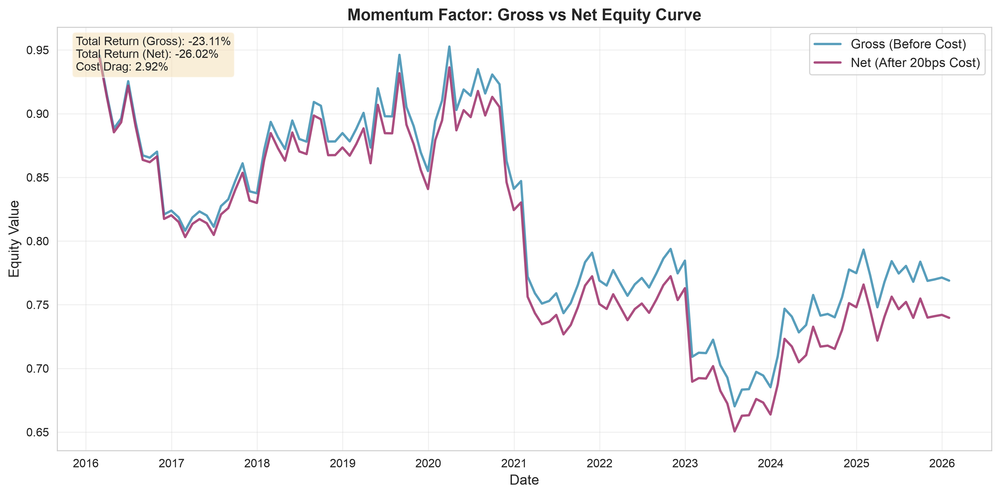
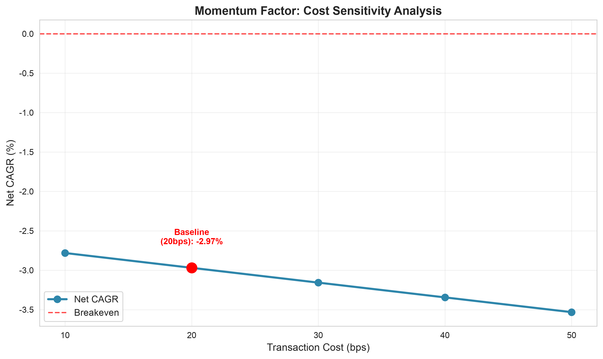
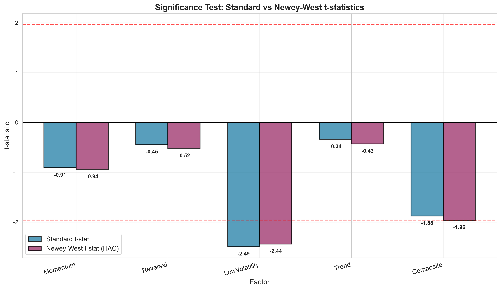

# Results Snapshot

> ⚠️ **本文档数字已过时（修复前的旧版结果）**。2026-11-15 修复了动量因子方向写反等多个影响结果的问题，
> 最新结果见 [README 第 9 节](../README.md) 和 [results/](../results/)。本文档仅作历史记录保留。

**更新时间**: 2026-02-05 | **数据来源**: [results/](../results/)

本文档提供系统核心结果的一页快照。

---

## 1. 性能总览表

| 因子 | 年化收益(净) | Sharpe | 最大回撤 | 年化波动 | 换手率 | 成本拖累 |
|------|-------------|--------|----------|----------|--------|----------|
| **Momentum** | **0.19%** | **0.1153** | **-20.68%** | **9.50%** | **17.91%** | **-0.41%** |
| Trend | -1.34% | -0.0846 | -27.71% | 9.50% | 20.24% | -0.46% |
| Reversal | -1.02% | -0.1949 | -19.06% | 5.76% | 36.47% | -0.83% |
| Composite | -4.64% | -0.6185 | -39.84% | 12.27% | 25.04% | -0.56% |
| LowVolatility | -8.87% | -0.7447 | -68.28% | 10.27% | 13.26% | -0.31% |

**关键发现**: 扣除20bps成本后，仅Momentum实现小幅正收益（0.19%），但统计检验显示**不显著**（Newey-West t=0.36, p=0.719）。

---

## 2. 核心图表

### 图1：Momentum毛收益 vs 净收益

**解读**: 交易成本消耗约**67.8%的毛收益**（10年累计：毛收益6.3% → 净收益1.98%）

---

### 图2：成本敏感性分析

**解读**: 成本**临界点30bps**，收益转负（-0.01%）。策略对交易成本高度敏感。

---

### 图3：显著性检验（t统计量）

**解读**:
- **Momentum**: 标准t=0.37, Newey-West t=0.36（均未超过1.96阈值，**不显著**）
- **通过检验的因子**: LowVolatility和Composite（但均为**负收益**）
- **结论**: 无正收益因子具有统计显著性

---

## 3. 关键结论

基于S&P 500样本（2016-2026, 121个月），20bps交易成本：

1. **收益有效性**: Momentum年化0.19%，但**缺乏统计显著性**（p=0.719）
2. **成本敏感性**: 30bps临界点后收益转负，实盘需严控成本
3. **市场暴露**: Momentum Beta=0.1862（超标），Alpha=-0.0018（接近零）
4. **稳健性**: 子样本表现差异大，时间稳健性不足

**最终判断**: 研究仅提供**弱证据（weak evidence）**支持因子产生稳定超额收益。需进一步实施Beta-Neutral中性化并在更长样本期、多市场环境下验证。

---

## 附录

- **完整报告**: [EVALUATION_REPORT.md](../results/EVALUATION_REPORT.md)
- **CAGR诊断**: [cagr_diagnostics.md](../results/cagr_diagnostics.md)
- **显著性检验**: [significance_summary.md](../results/significance_summary.md)
- **所有图表**: [results/figures/](../results/figures/)

---

*自动生成 | 数据截至 2026-02-05*
